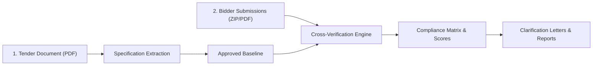

# TBE Workbench — Client User Guide & Demonstration Protocol

---

## 1. Executive Summary

**TBE Workbench** is an automated **Technical Bid Evaluation (TBE)** system designed to streamline and accelerate the evaluation of complex utility and infrastructure tenders.

By reading tender specifications and incoming bidder submissions, the platform extracts technical parameters, compares bidder offerings against mandatory requirements, identifies compliance deviations, and drafts official clarification letters.

This guide provides instructions for accessing and testing the demonstration environment, outlines the end-to-end evaluation workflow, and specifies important data confidentiality guidelines for this prototype phase.

---

## 2. Accessing the Platform

The live prototype is accessible directly via web browser without requiring local software installation:

* **Live Application URL:** [https://tbe-workbench-rwxeyrsm9q6qyvdo69cbxi.streamlit.app](https://tbe-workbench-rwxeyrsm9q6qyvdo69cbxi.streamlit.app)
* **Supported Browsers:** Google Chrome, Microsoft Edge, Mozilla Firefox, Safari (desktop view recommended).
* **Source Code Repository:** [GitHub Repository](https://github.com/Abhishek-Ojha-03/TBE-Workbench.git)

---

## 3. How the AI Model Works (High-Level Overview)

The workbench processes bids through a multi-stage validation workflow:

1. **Specification Ingestion:** Reads the employer's technical specification and Guaranteed Technical Particulars (GTP) tables, isolating mandatory clauses, qualification criteria (QR), and rated parameters.
2. **Baseline Approval:** Presents extracted criteria in an editable matrix where utility engineers can verify, modify, or add clauses prior to bidder evaluation.
3. **Automated Bid Verification:** Reads each bidder's technical proposal, locates matching clauses, extracts offered values, and checks them against the baseline criteria.
4. **Deviation & Compliance Scoring:** Classifies each parameter into one of three statuses:
   * **Complied:** Offered specification meets or exceeds requirements.
   * **Deviation:** Offered value fails to satisfy requirements (e.g., lower rating, missing feature).
   * **Needs Human Review:** Qualitative statements or ambiguous data requiring engineering judgment.
5. **Report & Clarification Generation:** Generates comprehensive comparative evaluation sheets (Excel/Word) and drafts official clarification letters for deficient bids.

---

## 4. End-to-End Walkthrough Guide

To evaluate the system using pre-loaded or new data, follow these steps in the sidebar navigation:

### Step 1: Select or Create a Tender
* Open the **Tender Management** tab.
* You may inspect the pre-configured reference project (e.g., *11kV Vacuum Circuit Breaker Tender*) or register a new tender with a distinct NIT/RFP reference number.

### Step 2: Upload Technical Specification
* Navigate to **Specification Upload**.
* Upload the employer's Technical Specification PDF.
* The system will ingest the document, extract numbered clauses, and compile the baseline requirements.

### Step 3: Review & Lock the Baseline Matrix
* Navigate to **Specification Review**.
* Review the extracted technical requirements, nominal ratings, and qualification criteria.
* Once verified, click **Approve / Lock Baseline**. All subsequent bidder comparisons benchmark against this locked version.

### Step 4: Ingest Bidder Submissions
* Navigate to **Bidder Submissions**.
* Upload bidder technical documents either individually as PDFs or packaged as a ZIP archive.
* The system extracts bidder data and performs automated clause-by-clause evaluation.

### Step 5: Review Evaluation Results & Summary Matrix
* Open **Evaluation Matrix & Findings**.
* View the side-by-side comparative table showing the required vs. offered parameters for each bidder.
* Inspect qualification ratings (Qualified / Disqualified / Pending Review).

### Step 6: Clarifications & Report Export
* Open **Clarification Engine** to view automatically drafted clarification queries for non-compliant or flagged items.
* Navigate to **Export Reports** to download the complete Technical Bid Evaluation dossier in **Excel (.xlsx)** or **Word (.docx)** format.

---

## 5. Important Confidentiality & Data Guidelines (Free Tier Notice)

> [!CAUTION]
> ### Prototype Stage Notice — No Confidential or Proprietary Data
> This demonstration environment currently operates on public cloud infrastructure utilizing **Google Gemini Cloud Free Tier APIs** for evaluation and demonstration purposes.
>
> In accordance with standard terms of service for cloud free-tier AI services:
> * **Do NOT upload live proprietary bids, commercial cost models, internal pricing formulas, or sensitive company-identifying details.**
> * **Do NOT upload tenders subject to active non-disclosure agreements (NDAs) or strict statutory confidentiality restrictions.**
>
> *Note: For enterprise production deployment, the platform integrates with dedicated on-premise infrastructure or isolated virtual private cloud (VPC) enterprise instances (such as Google Cloud Vertex AI, Azure OpenAI, or self-hosted LLMs) where all data remains strictly private, zero-retention, and isolated within your organization's perimeter.*

---

## 6. Recommended Data for Testing

To evaluate platform capabilities effectively during this demonstration phase, use the following document profiles:

| Document Category | Recommended Test Data | What to Avoid |
| :--- | :--- | :--- |
| **Tender Specifications** | Standard published public utility specifications (e.g., MSEDCL, BSES, NTPC, PGCIL, state electricity boards). | Active, unreleased tender drafts or proprietary private RFP documents. |
| **Bidder Proposals** | Publicly accessible vendor equipment brochures, technical catalogs, standard GTP sheets, or synthetic/anonymized sample bids. | Proprietary commercial proposals, confidential pricing sheets, internal partner margin data. |
| **Document Formats** | Clear digital PDFs (text-based or standard scanned documents with legible technical tables). | Password-protected PDFs, heavily corrupted scans, or encrypted archives. |
| **Typical Equipment Types** | Switchgears, Transformers, Circuit Breakers (VCB/SF6), Cables, HT/LT Panels, Inverters, Metering Infrastructure. | Multi-gigabyte CAD packages or non-PDF archive files. |

---

## 7. Operational Notes & Troubleshooting

* **Initial Page Load:** Because Streamlit Cloud suspends inactive demo containers, the application may take 15–30 seconds to wake up on the first visit.
* **Large PDF Documents (25+ Pages):** The system automatically engages pacing to respect API rate limits. During ingestion of large PDFs, please allow 1–2 minutes for clause extraction and GTP table aggregation to complete.
* **Refreshing Results:** If new bidder files are added, use the in-app **Re-evaluate / Refresh** buttons rather than browser hard-refresh to maintain active session state.

---

*For technical inquiries, enterprise deployment architectures, or private on-premise demonstrations, please contact the development team.*
